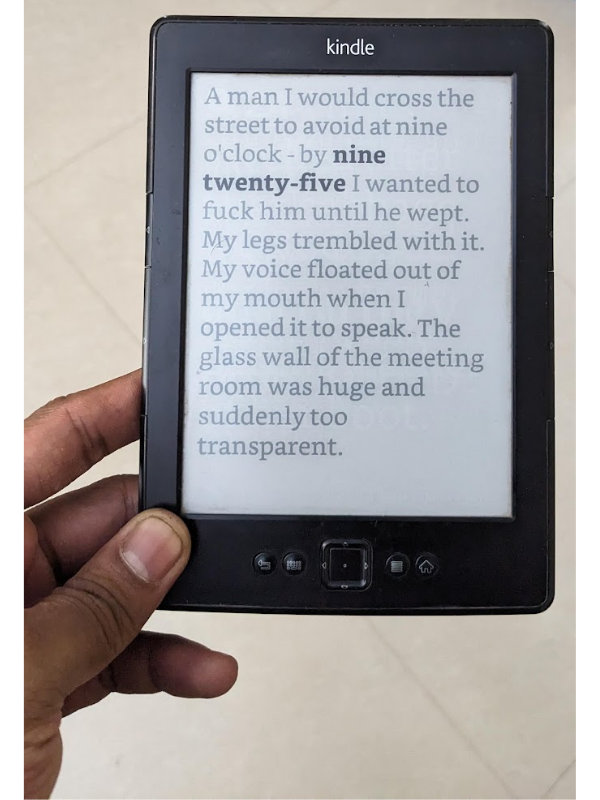

# A Second Heart

Turn a jailbroken Kindle into a literary clock: every minute is shown as a
real-book quote excerpt that contains that time.

The clock is non-destructive. It uses the Kindle screen while it is active,
but the Kindle can still return to its normal library after the clock is
stopped.

<p align="center">

</p>

## Current, tested setup

This repository currently documents a **Kindle 4 non-touch** with the physical
five-way controller. It has been set up with:

- a jailbreak;
- the MobileRead Kindlet Developer Certificates (MKK);
- KUAL, the Kindle Unified Application Launcher;
- USBNetwork, used for direct maintenance from a Mac; and
- the Literary Clock files in `/mnt/us/timelit/`.

The current corpus is
[`quote to image/litclock_annotated_br2.csv`](quote%20to%20image/litclock_annotated_br2.csv).
It contains **10,156** credited quote records and covers all **1,440** minutes
of the day. The generated images are deliberately not stored in Git because
the 600 x 800 set is about 400 MB.

## How the clock works

1. The corpus is rendered into files named `quote_HHMM_N.png`, such as
   `quote_1206_2.png`.
2. `timelit/timelit.sh` reads the Kindle's built-in system time. It does not
   change the time, timezone, or use the network.
3. When `clockisticking` exists, a once-a-minute scheduled task runs the
   script. The script picks a random image for the current minute and displays
   it with the Kindle screen tool.
4. `disable-clock` stops the clock and allows the normal screen saver again.

The small, plain numeric time screen is a fallback. It means the script ran
but could not find an image for that minute. With the current corpus that
should not happen: every minute has at least one image. A fallback that stays
on screen for a long time usually means the once-a-minute scheduled task has
stopped, not that the quote corpus is missing.

## Repository layout

| Path | Purpose |
| --- | --- |
| `quote to image/litclock_annotated_br2.csv` | The editable source corpus. |
| `quote to image/quote_to_image.py` | The original Python renderer. |
| `tools/validate_corpus.py` | Checks the corpus format, times, count, and credits. |
| `timelit/` | Files copied to `/mnt/us/timelit/` on the Kindle. |
| `timelit/timelit.sh` | Shows the quote image for the current minute. |
| `timelit/startstopClock.sh` | Starts or stops the display mode. |
| `launchpad/startClock.ini` | Legacy Launchpad shortcut configuration. |
| `sources/` | Archived Kindle installation files and references. |

## Build a corpus

The corpus has five pipe-separated columns:

```text
time|timestring|quote|title|author
```

`time` must be a 24-hour `HH:MM` value. `timestring` is the exact form shown
inside the source quote. The quote text, title, and author are all required.

Before rendering, validate the corpus from the repository folder:

```sh
python3 tools/validate_corpus.py --expected-records 10156 --require-credits
```

The source file is CSV in the sense that it uses rows and fields, but its
separator is `|` rather than a comma. Quotes containing `|`, quotation marks,
or line breaks must be saved with normal CSV quoting so standard CSV readers
can parse them correctly.

For long quotes, shorten only by removing complete sentences. Do not rewrite
words or punctuation, and keep the sentence containing the visible timestamp.

## Render the images

The renderer expects its CSV and fonts in the same `quote to image` folder.

```sh
cd "quote to image"
python3 quote_to_image.py
```

Keep rendered images outside Git. Before replacing the images on a Kindle,
count the output and make a backup of its existing `timelit/images` folder.
The current checked corpus renders to 10,156 PNG files.

## Install or refresh the Kindle corpus

The simplest reliable transfer is the mounted-drive method.

1. Connect the Kindle by USB and wait for it to appear as a drive on the Mac.
2. Back up the existing generated images before deleting them. Do not remove
   `timelit.sh`, `startstopClock.sh`, or the rest of `/mnt/us/timelit/`.
3. Delete old `quote_*.png` files from `/mnt/us/timelit/images/`. Also delete
   any incomplete temporary staging folder such as `images.new`.
4. Copy the entire fresh image set into `/mnt/us/timelit/images/`.
5. Confirm the Kindle contains the expected number of PNG files before
   ejecting it.
6. Safely eject the Kindle. Do not unplug it while files are still copying.

There must be enough free storage for the new image set. Keeping both a large
archive and the unpacked images on this Kindle can leave too little space, so
prefer copying the images directly over USB.

## KUAL and USBNetwork

KUAL is used on this Kindle to turn USBNetwork on and off. With USBNetwork
enabled, the Mac can connect directly to the Kindle at `192.168.15.244` over
the USB cable. This is useful for checking logs, running a single display
update, or repairing the built-in time.

If KUAL says that the device is not authorized as a test Kindle, or shows a
generic error when opened, the usual repair is to install the matching MKK
certificate update for the Kindle model and restart. KUAL should then show its
USBNetwork entry again.

Turn USBNetwork off in KUAL before using the Kindle as a normal USB drive. A
Kindle cannot reliably be a mounted USB drive and a USBNetwork device at the
same time.

## Starting and stopping the display

`clockisticking` starts the display mode and `disable-clock` stops it.
`timelit/startstopClock.sh` toggles those files and immediately draws one
image when starting.

The older Launchpad `C` shortcut in this repository applies to Kindle models
with a physical keyboard. A Kindle 4 non-touch does not have that key, so use
KUAL or a USBNetwork maintenance connection instead.

The device still needs a once-a-minute scheduled task that calls:

```sh
/bin/sh /mnt/us/timelit/timelit.sh
```

If the screen shows one quote and then never changes, check that scheduled
task first. If the screen shows a tiny numeric time, check the script log at
`/mnt/us/timelit/timelit.log` and confirm the images are in
`/mnt/us/timelit/images/`.

## Repair the Kindle's built-in time

This Kindle has no normal settings screen for changing the time. When the
clock drifts, or resets after a restart, connect through USBNetwork and set
both the running clock and the saved hardware clock in the same session.

The successful repair used the Mac's current local time in this form:

```sh
date MMDDhhmmYYYY.ss
hwclock -w
```

For example, `date 102114282026.26` sets 21 October 2026, 14:28:26. The second
command saves that value so it survives a restart. Always read back both
values with `date` and `hwclock -r` and compare them with the Mac before
disconnecting.

Do not put time-setting commands inside `timelit.sh`. That script must remain
display-only; otherwise the Literary Clock can make the Kindle's system time
jump unexpectedly.

## Safety notes

- Kindle modifications can leave the device unable to boot if the wrong
  update is installed. Use packages that match the Kindle model.
- Keep a copy of the corpus, rendered images, and `/mnt/us/timelit/` before a
  factory reset or major firmware work.
- Do not edit the root filesystem unless a specific maintenance task requires
  it. The clock images and scripts live in the USB storage area at `/mnt/us`.
- Some source quotes include adult language and are intentionally unedited.

## Credits

- Original project: [Literary Clock Made From E-reader](https://www.instructables.com/Literary-Clock-Made-From-E-reader/)
- Earlier Kindle clock scripts: [knobunc/kindle-clock](https://github.com/knobunc/kindle-clock)
- Expanded quote source: [JohannesNE/literature-clock](https://github.com/JohannesNE/literature-clock)
- Original crowdsourced project: [The Guardian literary clock](http://litclock.mohawkhq.com/)
